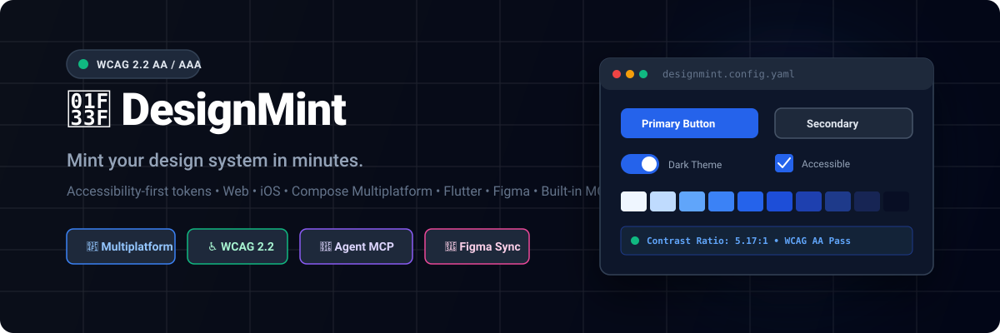
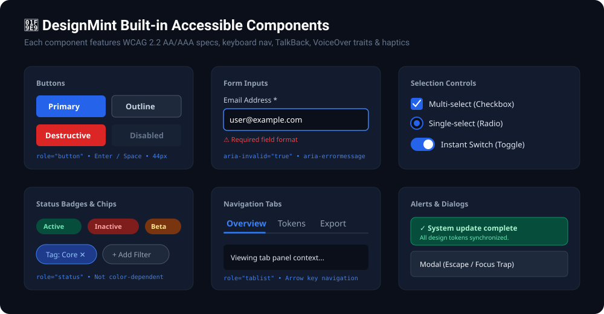
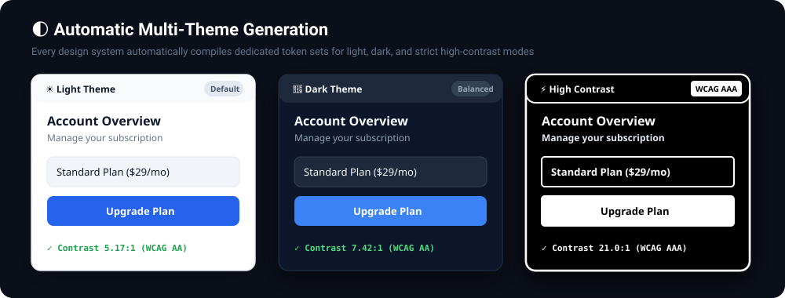
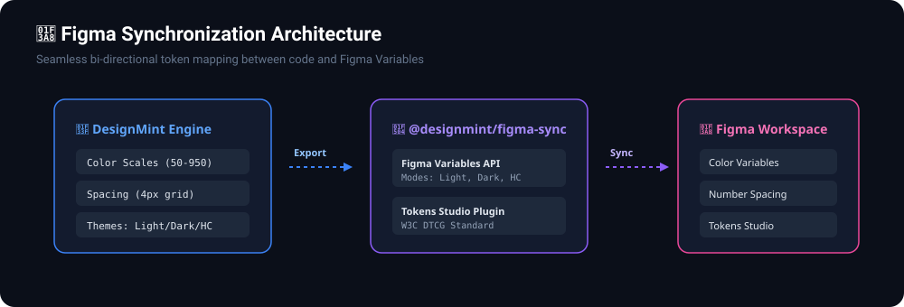

<div align="center">



# 🌿 DesignMint

**Mint your design system in minutes.**

*An accessibility-first design system generator with built-in components, multi-platform code export, Figma synchronization, and native MCP agent integration.*

[](https://github.com/mohitajwani/design-mint/actions/workflows/ci.yml)
[](LICENSE)
[](docs/accessibility.md)
[](docs/platforms.md)
[](docs/figma-sync.md)

[**🌐 Live Studio Experience Website →**](https://mohitajwani.github.io/design-mint/)

</div>

---

## 🎯 The Problem & The Solution

> **Do you feel AI generates very similar UI or you can instantly tell if an interface was designed by AI?**

Most AI coding agents default to the same generic color palettes, identical button roundings, and questionable contrast ratios.

**DesignMint is the answer.** It understands your brand identity, automatically generates an accessible token system, styles a comprehensive library of 15+ built-in components, aligns everything with Figma Variables, and exports production-ready code for Web, **Compose Multiplatform**, iOS, and Flutter.

---

## ✨ Key Capabilities

- **🎨 Intelligent Brand Generator**: Provide your brand hex colors, or just a single primary color — DesignMint compiles mathematically balanced 11-step HSL scales (50 to 950) with neutral slate tones.
- **♿ WCAG 2.2 AA / AAA Out of the Box**: Every color pair is audited for contrast (≥ 4.5:1 for AA, ≥ 7:1 for AAA). Built-in Brettel & Viénot color blindness simulator (protanopia, deuteranopia, tritanopia).
- **🌓 Automatic Multi-Theme Generation**: Generates unified tokens for **Light**, **Dark** (saturation-balanced), and **High Contrast** (WCAG AAA with 3px focus indicators and solid borders).
- **🧩 15+ Accessible Built-in Components**: Buttons, TextFields, Dropdowns, Checkboxes, Radios, Toggles, Cards, Tabs, Badges, Chips, Modals, Alerts, and Tooltips with ARIA roles, keyboard traversal, TalkBack, VoiceOver traits, and haptic feedback.
- **📱 Compose Multiplatform First-Class Support**: Generates `commonMain` Kotlin themes, colors, typography, shapes, and accessibility semantics for **Android, iOS, Desktop (JVM), and Web (Wasm)**.
- **🤖 Built-in MCP Server**: AI coding agents (Antigravity, Claude, Cursor) can query tokens, request component recommendations, and audit designs natively through Model Context Protocol tools.
- **🎨 Figma Bi-directional Sync**: Direct export to Figma Variables API collections (with Light, Dark, High Contrast modes) and W3C Design Tokens Community Group (DTCG) standard.

---

## 🖼️ Visual Showcase

### Component Library


### Multi-Theme Comparison


### Figma Synchronization Architecture


---

## 🚀 Quick Start

### Installation

```bash
# Global installation
npm install -g @designmint/cli

# Or in your project monorepo
npm install --save-dev @designmint/core @designmint/cli
```

### 1. Initialize Brand Configuration

```bash
designmint init
```

This creates a `designmint.config.yaml` with smart defaults:

```yaml
brand:
  name: "Acme Corp"
  colors:
    primary: "#2563EB"       # Your core brand color
    secondary: "#7C3AED"
    accent: "#F59E0B"
  typography:
    headingFont: "Plus Jakarta Sans"
    bodyFont: "Inter"
  accessibility:
    compliance: "AA"         # AA or AAA
    themes: ["light", "dark", "high-contrast"]
    reducedMotion: true
```

### 2. Run Automated Accessibility Audit

```bash
designmint audit
```

```
🔍 Running WCAG 2.2 Accessibility Audit for "Acme Corp"...

🟢 Accessibility Score: 95/100 (Target Level: WCAG AA)
Status: PASS
Passed: 18 | Warnings: 1 | Failures: 0

✅ [CONTRAST] Color "primary" (#2563EB) has contrast ratio 5.17:1 on #FFFFFF (Passes AA)
✅ [COLOR-BLINDNESS] Success & Error distinguishable under protanopia (dist: 115)
✅ [TOUCH-TARGET] Minimum touch target size 44px (WCAG 2.5.8 Compliant)
```

### 3. Generate Multi-Platform Code

```bash
# Mint tokens across all platforms
designmint generate --output dist/tokens

# Or target a specific platform
designmint generate --platform compose-multiplatform
designmint generate --platform web
designmint generate --platform ios
designmint generate --platform flutter
```

---

## 📱 Platform Targets

| Platform | Output Artifact | Key Capabilities |
|---|---|---|
| **Compose Multiplatform** | `commonMain/Theme.kt`, `Color.kt`, `Typography.kt` | Android, iOS, Desktop (JVM), Web (Wasm) with `Modifier.semantics` |
| **Web** | `tokens.css`, `tailwind.theme.js` | CSS custom properties with `@media (prefers-color-scheme)` & `@media (prefers-contrast)` |
| **iOS** | `DesignMintTokens.swift` | SwiftUI `Color`, UIKit `UIColor`, Dynamic Type, min 44pt touch target |
| **Android** | `colors.xml`, `dimens.xml`, `DesignMintTheme.kt` | Android XML resources, Material 3 Jetpack Compose theme |
| **Flutter** | `app_theme.dart` | Flutter `ThemeData`, `ColorScheme`, and `TextStyle` constants |
| **Figma** | `tokens.dtcg.json`, `figma-variables.json` | Figma Variables API collections & Tokens Studio plugin standard |

---

## 🤖 MCP Agent Integration

DesignMint includes a native Model Context Protocol (MCP) server that empowers AI agents to understand and use your design system:

```json
{
  "mcpServers": {
    "designmint": {
      "command": "node",
      "args": ["packages/mcp-server/dist/index.js"]
    }
  }
}
```

### MCP Tools for Agents:
- `recommend_component`: Ask *"Which component should I use for picking 3 filter categories?"* → Agent receives `Chip` with WAI-ARIA guidelines and keyboard shortcuts.
- `get_component`: Inspect complete design tokens, prop definitions, and screen reader annotations.
- `validate_contrast`: Instant mathematical WCAG 2.2 contrast checking between any two hex colors.
- `suggest_palette`: Generates an 11-step HSL scale and semantic colors from a single primary color.
- `export_tokens`: Exports ready-to-paste code for CSS, Tailwind, Compose Multiplatform, Swift, or Flutter.

---

## 🗂️ Monorepo Packages

```
packages/
├── core/            # Token generator, a11y engine, built-in components, exporters
├── cli/             # Command-line interface (`designmint init / generate / audit / recommend`)
├── mcp-server/      # Model Context Protocol server for AI coding agents
└── figma-sync/      # Figma Variables API and Tokens Studio synchronizer
```

---

## 🛠️ Development & Testing

```bash
# Install workspace dependencies
npm install

# Build all packages with Turborepo
npm run build

# Run complete test suite across all packages
npm run test
```

---

## 📄 License

MIT License © 2026 [Mohit Ajwani](https://github.com/mohitajwani).
